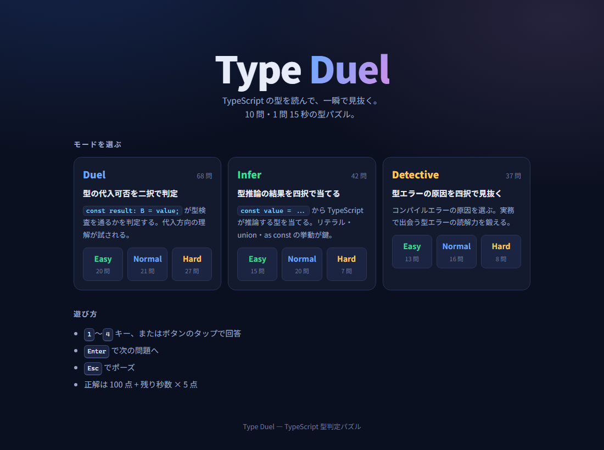
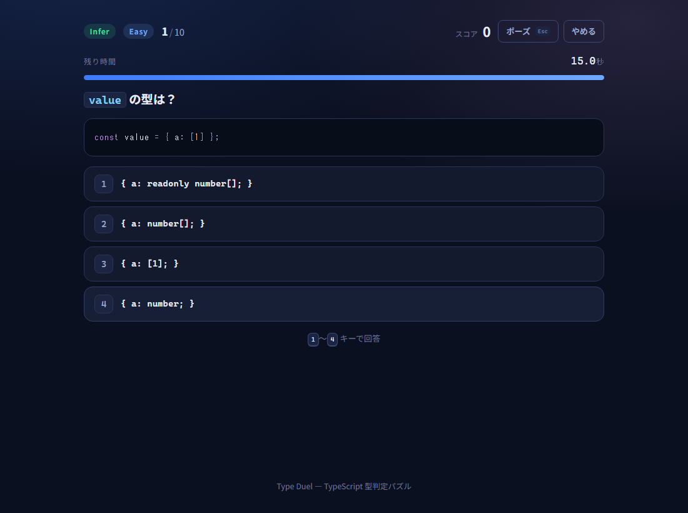
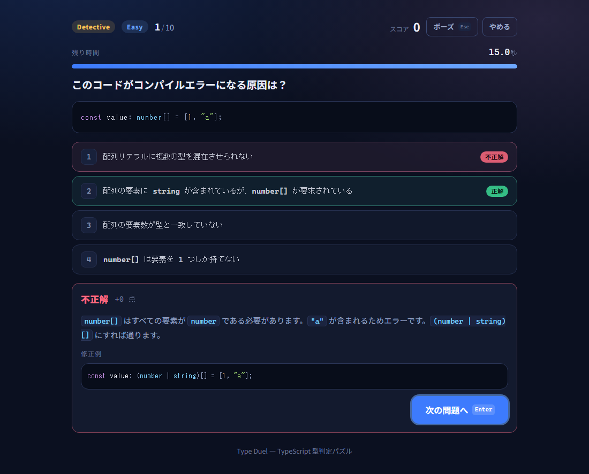

<div align="center">

# Type Duel

**TypeScript の型を読んで、一瞬で見抜く短時間型パズルゲーム**

[](https://github.com/tonbiattack/type-duel/actions/workflows/ci.yml)
[](https://github.com/tonbiattack/type-duel/actions/workflows/deploy.yml)
[](LICENSE)
[](https://www.typescriptlang.org/)
[](https://react.dev/)
[](https://vite.dev/)

[**▶ 今すぐ遊ぶ**](https://tonbiattack.github.io/type-duel/) ・ [仕様書](docs/SPEC.md) ・ [コントリビュート](CONTRIBUTING.md)



</div>

---

## これは何？

TypeScript の型を「読んで・予測して・判定する」ブラウザゲームです。
インストールもログインも不要で、開いた瞬間から遊べます。

1 問 15 秒。型の代入可否や推論結果を直感で見抜き、正解すると**なぜそうなるのか**の解説が読めます。
「なんとなく通った」で終わらせず、型のルールを体で覚えることを狙っています。

### 3 つのモード

| モード | 問われること | 回答形式 |
| --- | --- | --- |
| **Duel** | `const result: B = value;` が型検査を通るか | 二択 |
| **Infer** | `const value = ...` から推論される型は何か | 四択 |
| **Detective** | そのコンパイルエラーの原因は何か | 四択 |

<div align="center">


</div>

## 特徴

- **正解データをコンパイラで検証** — 全 147 問の正答を TypeScript Compiler API が CI で検証します。問題データの誤りはテストが落ちるため、`answer` の書き間違いが混入しません。
- **問題追加はデータ編集だけ** — `src/data/questions/` に 1 問足すだけで、検証・出題・採点に自動で乗ります。
- **キーボードだけで完走** — `1`〜`4` で回答、`Enter` で次へ、`Esc` でポーズ。
- **モバイル対応** — 大きなタップ領域、`prefers-reduced-motion` / `prefers-contrast` 対応。
- **サーバー不要** — 静的 SPA。外部 API・DB・認証はありません。

## 遊び方

1. タイトル画面でモードと難易度を選ぶ
2. 1 問 15 秒以内に回答する
3. 正誤と解説を確認して次へ。10 問終わると結果が表示される

| 操作 | キー |
| --- | --- |
| 回答 | `1` / `2`（Duel）、`1`〜`4`（Infer / Detective） |
| 次の問題へ | `Enter` |
| ポーズ / 再開 | `Esc` |

### スコア

| 項目 | 計算 |
| --- | --- |
| 正解 | 100 点 + 残り秒数 × 5 点（端数切り捨て） |
| 不正解・時間切れ | 0 点（連続正解はリセット） |

連続正解数は表示のみで、スコア倍率はかかりません。

### 難易度

| 難易度 | 扱うトピック |
| --- | --- |
| Easy | literal / primitive / union / array |
| Normal | object / optional / readonly / unknown / never / tuple |
| Hard | generic / conditional / indexed access / `keyof` / mapped types |

## はじめかた

### 必要なもの

- Node.js 22 以上
- npm

### セットアップ

```bash
git clone https://github.com/tonbiattack/type-duel.git
cd type-duel
npm install
npm run dev
```

`http://localhost:5173/` を開きます。

### スクリプト

| コマンド | 内容 |
| --- | --- |
| `npm run dev` | 開発サーバを起動 |
| `npm run build` | 型チェック + 本番ビルド（`dist/` を出力） |
| `npm run preview` | ビルド成果物をプレビュー（`http://localhost:4173/type-duel/`） |
| `npm run typecheck` | TypeScript の型チェック |
| `npm run lint` | ESLint |
| `npm run format` | Prettier で整形 |
| `npm run format:check` | 整形されているか確認 |
| `npm run test` | Vitest（1 回実行） |
| `npm run test:watch` | Vitest（ウォッチ） |
| `npm run verify` | typecheck → lint → test → build をまとめて実行 |

### 実ブラウザでの疎通確認（任意）

```bash
npm run build
npx vite preview --port 4173
# 別ターミナルで
node scripts/smoke.mjs
```

タイトル → 10 問プレイ → 結果画面までを Chromium で操作し、
コンソールエラーとモバイル幅の横スクロールを検査します。

## 問題を追加する

問題はデータファイルにだけ記述します。ロジックの変更は不要です。

```ts
// src/data/questions/easy.ts
duelQuestion({
  id: "easy-literal-to-string",       // 永続的に一意な kebab-case ID
  difficulty: "easy",
  topic: ["literal", "primitive"],    // 1 つ以上
  prompt: "リテラル型の値を string 型へ代入できるか？",
  code: `type A = "hello" | "world";
type B = string;

declare const value: A;
const result: B = value;`,
  assignable: true,                   // 正答が「代入できる」なら true
  explanation: "リテラル型は string の部分型です。",
}),
```

Infer と Detective は正解を明示します。

```ts
// Infer: コンパイラが返す型表記と完全一致させる
inferQuestion({
  id: "infer-const-string-literal",
  difficulty: "easy",
  topic: ["literal", "const"],
  prompt: "`value` の型は？",
  code: `const value = "hello";`,
  expectedType: `"hello"`,
  distractors: ["string", "unknown", "any"],
  explanation: "`const` はリテラル型として推論します。",
}),

// Detective: 期待する診断コードを指定する
detectiveQuestion({
  id: "detective-null-to-string",
  difficulty: "easy",
  topic: ["null", "strictNullChecks"],
  prompt: "このコードがコンパイルエラーになる原因は？",
  code: `const value: string = null;`,
  expectedErrorCode: 2322,
  cause: "strictNullChecks が有効なため、null は string に代入できない",
  distractors: ["null は予約語である", "string は null を許容する", "const では null を使えない"],
  explanation: "`strictNullChecks` が有効だと `null` は `string` の部分型ではありません。",
  fix: `const value: string | null = null;`,
}),
```

追加したら `npm run test` を実行してください。`tests/questions.test.ts` が
TypeScript Compiler API で全問を検証します。

### 検証の仕組み

| モード | 検証内容 |
| --- | --- |
| Duel | `const result: B = value;` の型検査結果が `answer` と一致するか |
| Infer | `checker.typeToString` の出力が `expectedType` と完全一致するか |
| Detective | 期待する診断コードが出るか、修正例がエラーを含まないか |

加えて以下も検証します。

- コンパイラ設定は `strict` / `strictNullChecks` / `noEmit` を固定
- TypeScript のバージョンは `package-lock.json` で固定（更新で判定が変わると CI が検知）
- 重複 ID・選択肢数・解説欠落・選択肢ラベルの重複をスキーマ検証で検出
- 難易度ごとの最低問題数、正解位置の偏りをチェック

問題作成時は、コンパイラが実際に何を返すかを確認できます。

```bash
node scripts/inspect.mjs infer 'const value = "hello";'   # => value: "hello"
node scripts/inspect.mjs diag 'const value: string = null;' # => TS2322: ...
```

## 技術スタック

| 領域 | 採用技術 |
| --- | --- |
| ビルド | Vite 8 |
| UI | React 19 + TypeScript 6 |
| スタイル | プレーン CSS（ダークテーマ） |
| テスト | Vitest 5 + Testing Library + TypeScript Compiler API |
| Lint / Format | ESLint 10 + Prettier 3 |
| CI / CD | GitHub Actions → GitHub Pages |

### 設計方針

- **ゲーム進行は純粋関数** — `src/lib/game.ts` に状態遷移を集約し、React から独立させています。二重回答・時間切れ・最終問題といった境界を UI を介さず直接テストできます。
- **問題データはスキーマで守る** — モード別の判別可能 union と実行時バリデーションの二段構え。
- **選択肢と正答をずらさない** — ヘルパー関数が正解の選択肢 ID を解決するため、対応ミスが構造的に起きません。

### ディレクトリ構成

```
src/
  App.tsx                 画面遷移・タイマー・キーボード操作
  components/             UI コンポーネント
  data/questions/         問題データ（モード・難易度別）
  lib/
    game.ts               ゲーム進行の純粋ロジック
    validate.ts           問題データのバリデーション
    highlight.ts          軽量シンタックスハイライト
    richtext.ts           インラインコードの解析
    config.ts             スコア・制限時間などの設定値
  types/question.ts       Question 型とモード・難易度定義
tests/                    ユニット・統合テスト
scripts/                  開発用ツール（疎通確認・問題作成補助）
```

## コントリビュート

Issue・Pull Request を歓迎します。詳しくは [CONTRIBUTING.md](CONTRIBUTING.md) を参照してください。

```bash
npm run verify   # 送る前にこれが通ることを確認
```

## ロードマップ

- [x] Duel モード（二択・タイマー・採点）
- [x] Infer モード（型推論の四択）
- [x] Detective モード（型エラー原因の四択）
- [ ] タイムアタック / エンドレスモード
- [ ] ローカル記録（最高スコア・復習）
- [ ] 問題のさらなる拡充

## ライセンス

[MIT](LICENSE)
